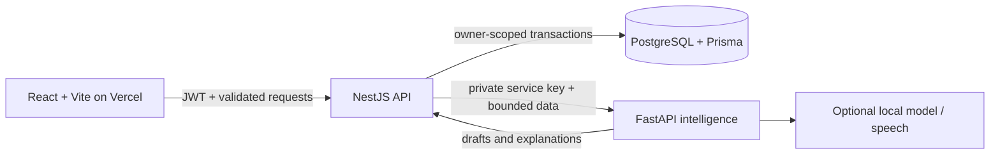

# SammTech AI OS

An original, voice-enabled productivity workspace built around the existing NestJS Kanban API. React provides the black-glass and neon-green workspace, Three.js renders Samm, and a separate Python service supplies explainable task assistance. PostgreSQL remains the source of truth and NestJS checks every write.

No commercial AI API key is required. Lightweight intelligence uses deterministic algorithms and TF-IDF search; it does not provide the reasoning ability of an instruction model. Optional local models can be installed separately.

## What is implemented

- JWT registration/login, per-user boards, five default columns, priorities, deadlines, task estimates, emoji labels, checklists, comments and task dependencies.
- Transactional task creation, deletion and reordering, including concurrent requests; soft-deleted boards cannot be used for new task actions.
- Dashboard, Kanban projects, AI assistant, voice workspace, agent center, command center, automations, planner, analytics, text files and device preferences.
- An original procedural 3D robot with an event-driven state machine, reduced motion and a lightweight fallback.
- Typed or spoken requests → Python interpretation → editable draft → explicit approval → authorized NestJS transaction → PostgreSQL → refreshed board and audit history.
- Browser speech recognition where supported, browser speech synthesis, microphone stop/cancel/mute, and optional local Whisper/Piper adapters. Browser recognition may use the browser vendor's service. Application recordings are not retained.
- Seven bounded, cancellable agent roles operating on authorized project data. The research role searches project tasks; it does not claim to browse the web.
- Saved automation rules, conditions, owner, enable/disable controls and execution history. Available actions create reports or approved recurring tasks; they do not run shell commands or send external notifications.
- Analytics derived from saved tasks and execution records, plus API/database/Python availability checks.
- Safe JSON task import/export and small text notes. Binary file storage is not implemented.

## Architecture



| Directory | Responsibility |
| --- | --- |
| `src/` | Existing NestJS API plus workspace gateway, agents, automations and audit events |
| `prisma/` | PostgreSQL schema, original baseline and reviewed additive migrations |
| `frontend/` | React/TypeScript, Tailwind, shadcn-style button, R3F/Drei, Motion, Query, Zustand, dnd-kit and Recharts |
| `ai-engine/` | Python 3.12/FastAPI, NumPy, scikit-learn and optional local inference/speech adapters |
| `test/` and `frontend/tests/` | Backend regression/integration tests and browser acceptance tests |
| `scripts/` | Safe migration startup and isolated migration verification |
| `docs/` | Deployment, migration, local Windows and security details |

## Local setup

Requirements: Node.js 22 LTS, npm, Python 3.12 and PostgreSQL 16. Docker Desktop is an optional way to run PostgreSQL. See [Windows setup](docs/LOCAL_WINDOWS.md) for PowerShell commands and optional local models.

1. Install dependencies:

   ```sh
   npm ci
   npm --prefix frontend ci
   python3.12 -m venv ai-engine/.venv
   ai-engine/.venv/bin/python -m pip install --require-hashes -r ai-engine/requirements-dev.lock
   ai-engine/.venv/bin/python -m pip install --no-deps -e ./ai-engine
   ```

2. Copy `.env.example` to `.env` and replace the database password and the three secret placeholders. Set a random `JWT_SECRET`, a different random `AI_SERVICE_KEY`, and a different `SCHEDULER_SECRET`, each at least 32 characters. Keep them out of Git. The Python service receives the same `AI_SERVICE_KEY` as NestJS. A random secret can be generated locally with `python -c "import secrets; print(secrets.token_urlsafe(32))"`.
3. For a new local database, run `docker compose up -d database`. Set `DATABASE_URL` to that database. For an existing database, first read [safe migration instructions](docs/MIGRATIONS.md) and take a backup.
4. Run migrations and compile:

   ```sh
   node scripts/migrate-safe.cjs
   npm run build
   ```

5. Start the services in three terminals. The local Python launcher reads the shared service key from root `.env` and removes API/database secrets from its child environment:

   ```sh
   # Repository root: Nest reads .env.
   npm run start:dev
   # Repository root: Python virtual environment must already be installed.
   node scripts/run-ai.cjs
   # Repository root: Vite proxies /api to port 5000.
   npm --prefix frontend run dev
   ```

Open `http://localhost:5173`, create an account and create a board. Enter “Create a task called Fix Login Bug by tomorrow” in AI Assistant, review it, and approve it. The task appears only after the API confirms persistence. Refresh the browser to check it remains.

Swagger is at `http://localhost:5000/api/docs`; liveness is `/`; database readiness is `/health/ready`. The authenticated `/workspace/health` endpoint includes Python availability.

## Cloud deployment

The frontend is prepared for **Vercel**, with its project Root Directory set to `frontend`. `frontend/vercel.json` builds Vite, enables SPA navigation and sets basic security headers. Set public build variable `VITE_API_URL` to the HTTPS NestJS API origin. Add the exact Vercel origin to the API's `CORS_ORIGIN` list. A configured frontend build does not establish that the API or database is live.

`render.yaml` targets the existing `Samtech-kanban-api` service in Virginia and defines a separate lightweight Python web service. It deliberately does not provision or replace PostgreSQL. Supply the existing `DATABASE_URL` securely and follow the migration guide. Models are not downloaded as part of deployment. Read [deployment instructions](docs/DEPLOYMENT.md) before applying the Blueprint.

Render free services sleep, have an ephemeral filesystem and share limited free instance hours. They cannot guarantee continuous background automation. Use an always-on worker or an authenticated external scheduler for dependable timing. Free PostgreSQL instances expire; choose a durable database and backups for valuable data. Details and current provider references are in the deployment guide.

## Validation

Run these checks after installation:

```sh
npm run build
npm run lint
npm test
npm --prefix frontend run build
ai-engine/.venv/bin/python -m pytest ai-engine/tests -q
npm audit
npm --prefix frontend audit
```

Database tests require an isolated database named `sammtech_test`; they refuse another name. Set its `DATABASE_URL` and test-only `JWT_SECRET` in the process environment, then run:

```sh
npx prisma migrate deploy
npm run test:integration
node scripts/verify-migrations.cjs
```

The migration verifier creates and drops only its own randomly named schemas inside that test database. It checks clean installation, exact legacy baselining with data preservation, and refusal of unexpected schema drift. Never point integration tests at production.

Browser acceptance testing uses the local frontend, API, Python and isolated PostgreSQL. See the Playwright configuration in `frontend/` for the available command and required local services. The CI workflow runs builds, Python tests, backend tests and migration checks with temporary PostgreSQL and test-only secrets; it does not deploy or access production credentials.

## Practical limits

- Lightweight NLP supports explicit English keywords and a limited set of date expressions, using UTC. Users review ambiguous requests and proposed deadlines.
- Semantic search is optional and needs a separately installed local embedding model. The default search is lexical TF-IDF.
- Instruction models, local Whisper and Piper require separately installed software and model assets. Their output quality and hardware speed vary; adapters require testing on the target machine. No Bangla support is claimed.
- Voice playback starts from user interaction and depends on browser permissions/voices. Browser synthesis uses approximate mouth animation; local audio can drive mouth amplitude. Advanced phoneme lip synchronization is not provided.
- Automations create workspace reports, not email/push notifications. Sleeping services may coalesce missed runs instead of replaying a backlog.
- Current completion trends use each task's present completion timestamp. Existing Done tasks get an approximate historic timestamp during migration; the chart is not a full immutable history of every status transition.
- Local preferences stay on the device and JWT sessions stay in the browser tab. Account recovery, email verification, collaboration and distributed rate-limit storage are future work.

See [security review](docs/SECURITY.md), [safe migrations](docs/MIGRATIONS.md), [Vercel/Render deployment](docs/DEPLOYMENT.md) and [Windows/local AI setup](docs/LOCAL_WINDOWS.md).
